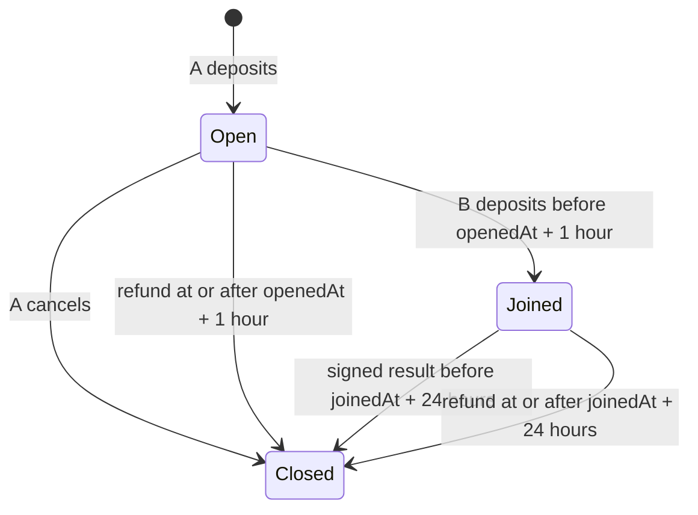

# NIGHTSHIFT GameEscrow v2

An immutable two-player escrow for Space Pinball, NIGHT CHESS and later skill games. Players choose an equal stake in IMD or SHIFT. A valid NIGHTSHIFT server result pays the winner the pot less a fixed 5% fee, or refunds both players on a draw.

The deployable application is **`src/GameEscrow.sol:GameEscrow`**. This is a new deployment; it does not modify or migrate funds from PinballEscrow v1 at `0x908da27d2caa584133dfb41fec9d6362dca6bcdd`.

## Build and test

The root Foundry project pins Solidity **0.8.26**, the Cancun EVM target, optimizer runs **200**, and `bytecode_hash = "none"`. All Solidity dependencies are vendored as ordinary files under `lib/`; no network, npm packages, submodules, FFI, filesystem cheatcode permissions or environment variables are needed by the tests. Foundry and the pinned compiler must already be installed on the verification machine.

```sh
forge build
FOUNDRY_FUZZ_SEED=0xf99244d597a9e540cf005491c1c502b9182f95e81013e78b343b270e3c46d373 forge test
forge fmt --check
sha256sum --check lib/SHA256SUMS
```

The default suite runs each parameterized fuzz test 1,024 times and the stateful model for 128 runs of 64 calls. [Validation and security notes](docs/SECURITY.md) describe the coverage and remaining launch review.

## Deployment parameters

The launch chain is **Ethereum, chain ID 1**. IdentityMD's deployment service builds and deploys the application through its factory after acceptance and independent review. This assignment supplies the application and a local CREATE/CREATE2 deployment rehearsal; it does not broadcast transactions or produce a live v2 address. The later manifest step supplies `launch.json`.

Constructor ABI: **`constructor(address initialSigner)`** (nonpayable).

| Parameter or fixed value | Launch value |
| --- | --- |
| `initialSigner` constructor argument | `$owner` = `0x6c4c78f2c3bdf4c4318fe305fb1c8bc1694d19b5` |
| Fixed `owner()` | `0x6c4c78f2c3bdf4c4318fe305fb1c8bc1694d19b5` |
| Fixed IMD | `0xd34a99bc0f67ae1bbd63c660e6d0b0dd03e263b7` |
| Fixed SHIFT | `0xe5e58e53d0bb204aa62c995a6c8cc8a48e60c3ac` |
| Fixed fee splitter | `0x1119d5df2f046bc2d3c0f6279ef2e9ce49422d44` |
| Fee | 500 basis points out of 10,000 |
| Join window | 3,600 seconds after `openedAt` |
| Settlement window | 86,400 seconds after `joinedAt` |

The only constructor argument is the initial signer. A zero signer is rejected. The launch must pass the owner address above; the constructor also supports other nonzero signer addresses for isolated deployments. Ownership is a fixed constant, independent of both `msg.sender` and `tx.origin`. No external calls, token-code checks, post-deployment initializer, proxy or library linking are needed to construct GameEscrow. `FactoryHarness` and `TestToken` live under `test/` and are not launch applications.

Both allowed tokens are specified to have 18 decimals, ordinary transfers, and no transfer fee or rebasing. Addresses and token behavior are taken from the approved brief; the local tests use mock code installed at those exact addresses, not a mainnet fork.

| Token | Initial minimum | Initial maximum | Immutable hard cap |
| --- | ---: | ---: | ---: |
| IMD | 0.5 | 1,000 | 10,000 |
| SHIFT | 10,000 | 50,000,000 | 1,000,000,000 |

All numbers in this table are whole-token quantities. Contract arguments and stored amounts are integer base units, scaled by `10^18`. For example, initial IMD minimum is `500000000000000000`; initial SHIFT maximum is `50000000000000000000000000`.

## Lifecycle and chosen boundary semantics

1. Player A approves the escrow for a selected token amount and calls `open(matchId, token, stake, game)`. Bounds are inclusive. `game` is an unrestricted `bytes32` label. The escrow checks the actual balance increase equals the selected stake.
2. A distinct player B approves the same token and calls `join(matchId)`. The contract takes the stored stake. There is no user-supplied amount or token in `join`. Changes to limits affect future opens only.
3. Anyone can relay a correctly signed `settle` before the settlement cutoff. The current result signer attests the winner or draw. The contract verifies the EIP-712 domain, all result fields, deadline, match state and winner eligibility.
4. An unjoined match can be cancelled immediately by A. Anyone can trigger a refund once the applicable timeout is reached. Funds always return to the recorded players; the caller cannot redirect them.



Timeouts are firm cutoffs: joining is refused at or after `openedAt + 1 hour`; settling is refused at or after `joinedAt + 24 hours`. Refunds become available at those exact timestamps. The 24-hour clock starts at **join**, not open. This prevents late transactions from defeating an already available refund. A signature remains valid at its own exact deadline (`block.timestamp <= deadline`), subject to the separate match cutoff. Pausing does not stop either clock.

`matches(matchId)` returns `(token, stake, game, playerA, playerB, openedAt, joinedAt, settled)`. The `settled` flag means **terminal**, including cancelled and refunded matches; distinguish the outcome using events. Records are retained forever, and no match ID can be reused after any outcome. Zero match IDs and zero game labels are valid; unused records are identified by absent `playerA`, not by stake, timestamp or label.

The owner may set any ordered inclusive bounds within the token's cap. Consistent with those constraints, a zero minimum is allowed if the owner explicitly chooses it, making zero-stake matches possible. Launch minima are strictly positive. No arbitrary step size or fixed denomination is imposed.

### Payouts and events

For a decisive result:

```text
pot    = 2 * stake
fee    = floor(pot * 500 / 10000)
payout = pot - fee
```

Integer rounding favors the winner: all remainder stays in the payout, with no trapped dust. For a stake of `1000000000000000007` base units, the pot is `2000000000000000014`, fee is `100000000000000000`, and payout is `1900000000000000014`. The hard caps keep every intermediate multiplication within `uint256`.

A draw refunds exactly one stake to each player, with zero fee. On a draw, the signed `winner` is ignored for transfers and can be any address; it is still signed and emitted. In `Settled(matchId, winner, draw, payout, fee)`, `payout` means the **winner's total payout** for a win, and the **refund to each player** for a draw.

Lifecycle events are `Opened`, `Joined`, `Settled`, `Refunded`, and `Cancelled`. Administrative events are `SignerSet(previousSigner, newSigner)`, `LimitsSet(token, min, max)`, `Paused(account)` and `Unpaused(account)`. Initial signer and limits are emitted during construction. Lifecycle state and events are written before token interactions; any failed transfer reverts the entire transaction, including prior transfers, state and events.

## Administration and custody

Only the fixed owner can call `setSigner`, `setLimits`, `pause`, and `unpause`. Pause blocks only opens and joins. Settlement, timeout refunds and cancellation continue working. There is no ownership transfer or renunciation, token-list mutation, fee change, recipient change, arbitrary execution, approval, rescue, withdrawal, upgrade, `delegatecall` or `selfdestruct` interface.

The server signer is trusted to report the true skill-game result. An owner who controls or rotates that signer can influence which recorded player wins, or declare a draw, but cannot name a third-party payout recipient. A compromised server key can therefore harm players even though it cannot arbitrarily sweep the escrow. The maximum at risk per match is twice its stored stake.

Only `open` and `join` create deposit liabilities. Direct ERC-20 donations do not increase any pot. They cannot be rescued, because no stake-moving administrative power is allowed. Do not directly transfer tokens or native ETH to the escrow. If an allowed token later changes behavior or refuses transfers, that token's affected payout can fail; state rolls back and the same action can be retried. Other matches have independent execution paths.

## After launch

- The deployment service records the confirmed v2 address and publishes verified source with the pinned build settings. Confirm `owner()`, `signer()`, token constants, fee recipient, limits and EIP-712 domain before enabling deposits.
- The owner operates the launch signer initially. If NIGHTSHIFT uses a dedicated server EOA, the owner calls `setSigner(serverAddress)` using an address supplied by the server operator. Rotation immediately invalidates pending signatures from the old key; pending matches must be re-signed or refunded at timeout. Setting an old signer again can revalidate its still-live signatures for unfinished matches, so retired compromised keys must not be restored.
- NIGHTSHIFT validates the actual game outcome and the confirmed on-chain match before signing. It manages unique match IDs, expected player identities, game/session bindings, confirmation policy, deadlines and relaying. [Integration details](docs/INTEGRATION.md) provide the exact typed-data schema.
- The owner chooses future limits with `setLimits(token, min, max)` and monitors signer compromise and token health. `pause()` can stop new deposits during incidents; it cannot freeze exits. The fixed owner key must remain available for future administration.
- A frontend or keeper submits refunds when deadlines pass; there is no automatic transaction scheduler and no keeper fee. Refunds are permissionless. Players can also cancel eligible lobbies or submit a signed result themselves.
- An independent contributor performs the separate adversarial review before release. The local tests and self-review are not that review. No funded account, key or mainnet transaction was used in this assignment.
